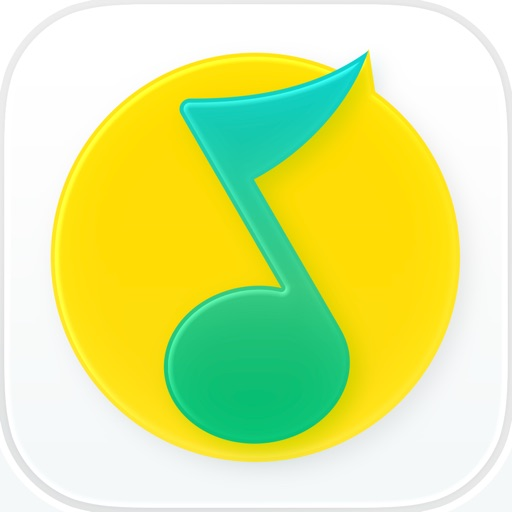

# QQ 音乐 SVIP 启动动画屏蔽

屏蔽指定 CDN 下的 SVIP／钻石启动动画素材。

收录用户提供的修复版，保留原规则：仅匹配 `qkcdn6-media.tencentmusic.com` 的 `/beta/test/`、`/beta/videov2/` 下，文件名为 32 位十六进制字符串的 MP4。此插件不包含会员解锁功能，也不处理音乐播放权限。

## 安装

在 Loon 的插件页面添加远程订阅：

```text
https://raw.githubusercontent.com/LuxJon/Loon-Rules/main/Plugins/QQ%E9%9F%B3%E4%B9%90%E5%90%AF%E5%8A%A8%E5%8A%A8%E7%94%BB%E5%B1%8F%E8%94%BD/QQMusic_SVIP_Loading_fixed.plugin
```

启用插件及所需的复写／MitM，安装并信任 Loon 证书。替换原本地版本时，停用同功能旧插件，避免重复处理。

无需 JS。本次只增加图标并转为远程订阅，未重新进行手机实测；若后续 CDN 或素材路径变化，需要更新匹配规则。
