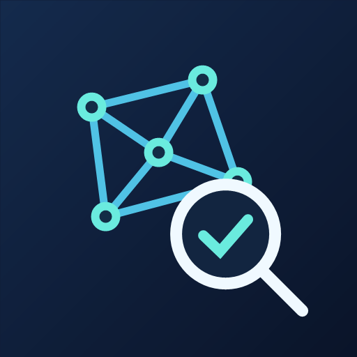

# Loon 工具集

> 个人自用的 Loon工具集。

收纳个人使用的 Loon 插件、配套脚本和分流规则。插件目录和文件使用易懂的英文名称，各目录内提供中文说明及直接订阅地址。点击插件名称查看说明，点击订阅导入 Loon。

## Loon 插件

| 图标 | 插件 | 功能与状态 | 远程订阅 |
| --- | --- | --- | --- |
|  | [节点检测整合](./Plugins/NodeTools/) | 节点 IP 质量、入口落地、地理位置三个独立查询入口。 | [订阅](https://raw.githubusercontent.com/LuxJon/Loon-Rules/main/Plugins/NodeTools/NodeTools.lpx) |
|  | [Bilibili 竖屏优化](./Plugins/Bilibili/) | 移除竖屏「上滑观看」提示，关闭直播预览倒计时自动进入。 | [订阅](https://raw.githubusercontent.com/LuxJon/Loon-Rules/main/Plugins/Bilibili/Bilibili.lpx) |
|  | [豆瓣去开屏广告](./Plugins/Douban/) | 拦截开屏广告决策、竞价和预加载，提供可关闭的广告 SDK 兜底防护。 | [订阅](https://raw.githubusercontent.com/LuxJon/Loon-Rules/main/Plugins/Douban/Douban.plugin) |
|  | [西窗烛会员解锁](./Plugins/Xichuangzhu/) | 收录本地会员解锁配置；其原第三方脚本地址当前返回 404，暂不可用。 | [订阅](https://raw.githubusercontent.com/LuxJon/Loon-Rules/main/Plugins/Xichuangzhu/Xichuangzhu.plugin) |
|  | [QQ 音乐 SVIP 启动动画屏蔽](./Plugins/QQMusic/) | 屏蔽指定 CDN 下的 SVIP／钻石启动动画素材。 | [订阅](https://raw.githubusercontent.com/LuxJon/Loon-Rules/main/Plugins/QQMusic/QQMusic.plugin) |

在 Loon 的插件页面添加对应订阅地址。豆瓣、Bilibili、QQ 音乐使用复写；节点检测和西窗烛依赖脚本，具体要求见各插件说明。

## Loon 分流规则

| 服务 | 规则文件 | 远程订阅 |
| --- | --- | --- |
| Binance | [Binance.list](./Rules/Binance.list) | [Raw](https://raw.githubusercontent.com/LuxJon/Loon-Rules/main/Rules/Binance.list) |
| Bybit | [Bybit.list](./Rules/Bybit.list) | [Raw](https://raw.githubusercontent.com/LuxJon/Loon-Rules/main/Rules/Bybit.list) |
| Emby | [Emby.list](./Rules/Emby.list) | [Raw](https://raw.githubusercontent.com/LuxJon/Loon-Rules/main/Rules/Emby.list) |

在 Loon 中添加远程规则时使用对应 Raw 地址，并按需要选择策略。

Bybit 规则收录自 [wuleaves/bybit-loon-rules](https://github.com/wuleaves/bybit-loon-rules/blob/main/Bybit.list)，保留源文件内容。
